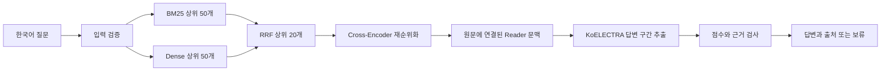

# 시스템 구조

한국어 질문을 입력받아 원문에 있는 답변 구간과 출처를 반환하거나 답변을 보류합니다. 검색기는 근거 후보를 찾고, 재순위화 모델은 후보 순서를 조정하며, Reader는 원문 문맥에서 답을 추출합니다. 마지막으로 응답 기준에 따라 답을 반환할지 정합니다. 청크는 검색용 텍스트 조각, 벡터는 유사도 비교를 위한 수치 표현, 상위 문맥 구간은 주변 원문을 복원한 범위입니다. 관련 문단을 잘 찾았다고 답도 정확한 것은 아니므로 각 단계를 따로 평가합니다.

[English](architecture.md) | [한국어](architecture.ko.md)

고정한 KorQuAD 문서에서 한국어 질문의 근거를 검색하고 답변 구간을 추출하는 시스템입니다. 답과 출처를 함께 반환하거나 답변을 보류하며, 외부 LLM API 없이 실행합니다.

## 검색과 원문 연결

BM25와 벡터 검색은 동일한 청크 목록을 사용합니다. 문장 임베딩에는 마스킹한 평균 풀링과 L2 정규화를 적용하고 FAISS 내적 검색으로 후보를 찾습니다. E5에는 모델이 요구하는 `query:`와 `passage:` 접두어를 붙입니다. 점수의 척도가 다른 두 검색 결과를 RRF로 결합한 뒤 Cross-Encoder가 후보의 순서를 조정합니다.

청크는 토큰 길이, 겹침 구간, 원문 문자 위치를 기준으로 생성하며 정답 위치를 사용하지 않습니다. 검색 재현율은 올바른 문단의 청크에 주석으로 지정된 정답 구간 전체가 포함됐는지 평가합니다. Reader 문맥을 넓힐 때도 검색한 구간을 중심으로 원문을 읽으며, 정답 위치로 문맥을 정하지 않습니다.

## 답변 판단

Reader는 원문 안에서 길이가 제한된 시작점과 끝점을 선택하고 CLS의 무응답 점수와 비교합니다. 검색 점수, 재순위화 점수, Reader 점수, 명시된 네 자리 연도와 원문 문자열 일치를 검사합니다. 개선 구성에는 점수가 거의 같은 경계 사례를 보류하는 고정된 보정값을 적용합니다. 이 점수는 선택 기준이며 정답 확률로 보정한 값은 아닙니다.

인용은 답변 문자열의 위치를 보여 줍니다. 잘못 고른 문자열도 원문에 존재할 수 있고 인용한 문서가 질문에 적절하지 않을 수도 있습니다. 통제한 무응답 평가도 제한된 실패 유형을 측정하며, 모든 질문에 대한 오류 방지를 입증하지는 않습니다.

## 실행과 모델 파일

런타임은 로컬 Hugging Face `safetensors` 모델, JSON 설정, JSONL 원문 정보와 FAISS 인덱스를 읽고 검증한 청크에서 BM25를 구성합니다. 모델을 불러오기 전에 파일 크기와 SHA-256 해시가 정확한 목록과 일치하는지 검사합니다. 누락, 변조, 링크, 원문과 청크의 불일치가 발견되면 원인을 안내합니다.

공개 다운로드에는 모델 가중치와 인덱스를 포함합니다. 원문과 청크는 변경하지 않은 공식 KorQuAD 파일에서 기록한 ID와 문자 위치로 사용자 컴퓨터에 재구성해 데이터 출처를 확인할 수 있습니다.

연속 질문과 일괄 처리에서는 모델을 한 번 불러와 재사용합니다. 입력 검증, CPU와 CUDA 선택, JSON 출력도 제공하며 연속 질문 중 잘못된 입력이 들어와도 세션을 유지합니다. 설치, 평가, 학습과 추론의 실행 경로를 `scripts/`와 `korean_rag/`로 나눴습니다.

## 학습과 평가의 경계

질문과 문단 검색을 위한 검색기 학습과 재순위화 추가 학습은 선언한 학습 데이터만 사용합니다. Hard Negative 생성에서는 정답을 포함하거나 관련된 긍정 문단을 제외합니다. 무작위 오답과 어려운 오답의 재순위화 학습은 질문 ID, 초기 가중치, 최적화 조건을 공유합니다. 이미 학습한 모델의 추가 개선 비교라는 범위에서 결과를 해석합니다.

개발 평가에서 모델, 청크, Reader 문맥과 답변 기준을 선택하고 구성과 코드 및 모델 파일의 해시를 동결한 뒤 최종 추론을 수행합니다. 학습 노트북과 개인 기록은 공개 소스 밖에 보관하며 재현 가능한 학습 코드와 측정에 따른 채택 판단을 공개합니다.
