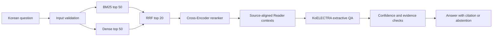

# Architecture

The input is a Korean question and the output is a source-backed answer span or an abstention. Retrieval finds promising passages; reranking orders that shortlist more carefully; the Reader extracts an answer from a source window; acceptance rules decide whether to return it. A chunk is a searchable text piece, a vector represents text numerically for similarity search, and a parent window restores nearby source context. These stages are evaluated separately because a good retrieved passage does not guarantee a correct extracted answer.

[English](architecture.md) | [한국어](architecture.ko.md)

The system answers Korean questions using a fixed, locally indexed KorQuAD corpus. It retrieves evidence, extracts an answer span and returns a source citation or abstains. It does not require an LLM API.

## Retrieval and source alignment

The sparse and dense searches use the same chunk inventory. Dense embeddings use masked mean pooling, L2 normalization and FAISS inner-product search. E5 inference adds the model's required `query:` and `passage:` prefixes. Reciprocal Rank Fusion combines ranks instead of incomparable sparse and dense scores. A Cross-Encoder reranks the fused candidates without adding new documents.

Natural chunks use token windows, overlap and source character offsets. Chunk construction never consults answer annotations. Recall requires a returned chunk from the correct paragraph that contains the complete annotated answer span. Larger Reader windows remain centered on retrieved source intervals; gold answer locations never determine the inference window.

## Answer decisions

The Reader selects a bounded start/end span inside a source context and compares it with its CLS null answer. The policy checks retrieval, reranker and Reader confidence, explicit four-digit years, and exact source containment. A fixed conservative null-score margin rejects unstable near ties in the improved configuration. These scores are selection signals, not calibrated correctness probabilities.

A citation establishes where the extracted text appears. A wrong span can still have a valid citation, and a cited document can still be irrelevant to the question. The controlled no-answer suite measures one limited failure mode and does not establish universal hallucination prevention.

## Portable artifacts and execution

The runtime reads local Hugging Face `safetensors` models, JSON configuration, JSONL source metadata and a FAISS index. It rebuilds BM25 from the verified chunks. Runtime artifacts are checked against an exact manifest of file sizes and SHA-256 hashes before model loading. Missing, modified, linked or misaligned files produce an actionable error.

The public download contains model weights and index artifacts. Source documents and chunks are reconstructed locally from an unchanged official KorQuAD download, using recorded IDs and offsets. This also makes corpus provenance explicit.

Persistent interactive and batch modes load the models once and reuse them. The CLI validates questions before inference, handles invalid interactive input without ending the session, supports CPU and CUDA and emits machine-readable JSON. Installation, benchmarks, training and inference have separate entrypoints under `scripts/` and `korean_rag/`.

## Training and experiment boundaries

Question-to-passage retriever training and matched reranker refinements use only the declared training data. Hard-negative mining filters gold-bearing and related positive passages. Random and hard-negative reranker arms share question IDs, initial weights and optimization policy; their result is an additional-refinement comparison, not a clean first-training comparison.

Development data select models, chunking, Reader context and acceptance thresholds. A frozen configuration and source/artifact hashes precede final inference. Original learning notebooks and personal experiment journals are retained privately outside the public source; reproducible training code and measured decision records remain public.
